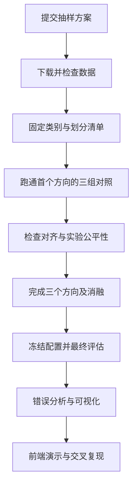

# 题目6 Office-Home 与 Deep CORAL 实验流程及下载说明

更新日期：2026-11-03。用途：组内讨论与执行。选题、数据集和方法已确定；迁移方向、模型和训练配置为暂定建议，须根据数据体检与试跑结果调整。

课程验收依据为老师提供的机器视觉分组实验任务书。[^1]

## 1 当前方案与任务要求

本项目研究无监督域自适应：使用有标签的源域图片和无标签的目标域图片进行训练，检查 Deep CORAL 能否改善目标域分类表现。已确定使用 Office-Home 数据集和自实现 Deep CORAL；暂定使用 ImageNet 预训练 ResNet18，分类头改为65类。[^2][^3][^4]

### 老师明确要求

以下要求来自同目录的[实验任务书](./20261028-机器视觉-实验课程-分组实验任务书.docx)，是验收依据，不是新增建议。

| 项目 | 要求 |
| --- | --- |
| 方法 | 自实现 CORAL 二阶统计对齐；不整体调用现成适配框架 |
| 迁移任务 | 至少三个方向，报告目标域准确率 |
| 对照 | 源域直接测试、目标域有监督训练 |
| 分析 | 适配前后 t-SNE，判断有无特征坍缩 |
| 前端 | 选择源域／目标域模型，上传图片查看预测及特征投影 |
| 通用功能 | 单图、批量、示例图、结果可视化、耗时显示 |
| 资源 | 数据解压后不超过5 GB；全量下载前先提交抽样方案 |
| 训练与推理 | 单次训练不超过4小时；CPU单图不超过500 ms；前端整体响应不超过3秒 |
| 模型 | 参数量不超过30 M；分类输入分辨率不超过384；PyTorch 2.x |

题目6未规定统一的准确率最低数值，但需要可信的对照、失败诊断和结论。任务书总体进度要求第2周基线接近参考值；使用自定划分时，应先向老师确认可比参考配置，不能直接套用其他协议下的论文成绩。

### 本方案的建议

- 先完成一个方向的三组对照，再扩展到三个方向。
- 先使用 ResNet18 和单层特征对齐，避免同时改骨干、损失和数据增强。
- 主流程在笔记本上完成；开发板部署作为后续扩展，不作为首版必做项。
- 如实保留负迁移与失败结果，不以目标域测试集挑选方向、权重或参数。

## 2 Office-Home 下载与数据准备

### 数据集是什么

Office-Home 包含约15,500张图片，四个域共享65个日常物体类别。域名及目录名要以实际解压结果为准；原始官网使用下列域名。图片精确数量、文件体积和完整性需要下载后实测，不能把官网近似数当作本地校验结果。[^2]

| 缩写 | 域名 | 图片特点 |
| --- | --- | --- |
| Ar | Art | 艺术表达的物体图片 |
| Cl | Clipart | 剪贴画 |
| Pr | Product | 商品图片 |
| Rw | Real World | 真实场景图片 |

### 下载前的抽样方案

任务书要求全量下载前先提交抽样方案。以下文字可作为提交初稿，是否已提交目前尚未确认。

“拟使用 Office-Home 四个域和全部65类，先按域与类别分层，每个单元抽取最多10张图片进行小规模体检和训练链路验证，最多约2,600张。若官网仅提供整包，先完成抽样方案提交，再获取整包并据固定清单抽样。正式实验优先保留四域65类全量数据；下载后统计解压体积。若超过5 GB，或预计单次训练超过4小时，按域与类别采用统一、固定种子的样本上限，公布保留和排除数量，不根据模型测试成绩选图。所有正式方法使用同一份数据及划分清单。”

小规模样本只用于检查数据和代码，不用于挑选最终方案。正式划分前可以排除这些调试图片，避免它们进入最终测试集；确认排除数量并记录原因。

### 首选下载方式

1. 打开[Office-Home 官方页面](https://www.hemanthdv.org/officeHomeDataset.html)。[^2]
2. 找到 `Download`，点击 `Dataset Download`。
3. 官网当前指向[Google Drive 压缩包页面](https://drive.google.com/file/d/0B81rNlvomiwed0V1YUxQdC1uOTg/view?usp=sharing&resourcekey=0-2SNWq0CDAuWOBRRBL7ZZsw)，文件名为 `OfficeHomeDataset_10072016.zip`。保留链接中的 `resourcekey`。[^5]
4. 在该文件页面点击下载，建议将压缩包放到 `大作业/data/downloads/`。若浏览器要求登录，按页面提示处理。
5. 解压到 `大作业/data/raw/`，保留原始域名和类别目录。不要把所有域混放在一个分类文件夹中。

建议的本地结构如下。当前已创建 `data/downloads/` 并准备好压缩包；`raw/`、`splits/` 尚未创建，解压得到的外层目录名可以不同：

```text
大作业/
  data/
    downloads/
      OfficeHomeDataset_10072016.zip
    raw/
      OfficeHomeDataset_10072016/
        Art/
        Clipart/
        Product/
        Real World/
    splits/
      class_to_idx.json
      train.csv
      val.csv
      test.csv
```

可在项目自己的 PowerShell 中解压。下面是下载完成后使用的命令，本次未执行：

```powershell
Set-Location -LiteralPath 'D:\Xx\大三上\机器视觉\大作业'
New-Item -ItemType Directory -Path '.\data\raw' -Force | Out-Null
Expand-Archive -LiteralPath '.\data\downloads\OfficeHomeDataset_10072016.zip' -DestinationPath '.\data\raw'
```

如果 Google Drive 访问受限，优先请老师或同学从官方入口统一获取后分发；仅换下载工具无法解决网络不可达。DomainBed 维护者的[下载脚本](https://github.com/facebookresearch/DomainBed/blob/main/domainbed/scripts/download.py)也列有 Office-Home 的另一个 Drive 地址，可以作为备用来源线索，仍需检查文件内容，不能假定与官网包完全相同。不要直接运行整份脚本，其默认执行项未必是 Office-Home。[^6]

官网将数据用于非商业研究和教育，并提供对应论文引用。课程报告应注明来源和用途；不要把原始图片或模型权重打包提交到代码仓库。前者来自官网使用说明，后者也是任务书要求。[^2]

### 下载后实际检查

- 检查压缩包能否完整解压，记录下载地址、日期、压缩包 SHA-256 和解压后的总字节数。
- 检查四个域是否齐全，每域是否覆盖相同65类，建立唯一的 `class_to_idx.json`。
- 逐图读取，统计损坏图片、尺寸、通道、各域各类数量、重复及近重复图片。
- 排查跨域、跨划分的近重复泄漏；存在冲突标签的图片要人工检查并记录处理方式。
- 保存原始数据，后续通过清单引用图片，避免为训练／验证／测试重复复制整份数据。

## 3 迁移任务与数据协议

### 暂定三个方向

| 顺序 | 方向 | 目的 |
| --- | --- | --- |
| 1 | Rw → Pr | 先用真实场景到商品图跑通完整链路 |
| 2 | Pr → Cl | 检查商品图到剪贴画的适配 |
| 3 | Cl → Ar | 检查剪贴画到艺术图片的适配 |

这是提前确定的实验组合，不代表已证明哪个方向更容易。第一版不做全部12个有向组合。

### 暂定留出划分

采用课程实验的独立测试集方案：在去重分组后，尽可能按“域＋类别”分层划分为70%训练、15%验证、15%测试，固定划分种子为42。各类别保持测试覆盖；小样本类的取整和重复组处理须在数据报告中说明。若老师指定划分，统一替换为指定协议。

| 数据部分 | Source-only | Deep CORAL | Target-supervised |
| --- | --- | --- | --- |
| 源域训练集 | 图片和标签 | 图片和标签 | 不使用 |
| 源域验证集 | 选择检查点 | 选择检查点 | 不使用 |
| 目标域训练集 | 不使用 | 仅图片 | 图片和标签 |
| 目标域验证集 | 不使用 | 不使用标签 | 选择检查点 |
| 目标域测试集 | 最终评价 | 最终评价 | 最终评价 |

目标域训练目录本身可能带有类别名，适配数据加载器应只返回图片与样本编号，不返回类别给训练循环。全局类别映射用于数据管理和最终评估，不用于目标域训练监督。

目标域有监督参照应独立初始化、独立训练；其权重和选参结果不得回流给无监督适配方法。三个迁移任务也独立训练，不串联使用其他方向的已训练权重。

主实验预先固定对齐权重和选模规则，采用源域验证准确率选择适配检查点；不能因为目标域测试成绩低就反复更换参数。该规则可复现，但不保证选到目标域最优模型。

本方案不是直接复现标准论文排行榜。原始 Deep CORAL 使用的骨干、数据集及目标域数据使用协议与这里不同，报告须明确差异。[^4]

## 4 模型与 Deep CORAL 实现

### 暂定起点

| 配置 | 暂定值 |
| --- | --- |
| 骨干 | torchvision ResNet18，ImageNet 预训练 |
| 分类头 | 65类，随机初始化 |
| 输入 | 224 × 224 |
| 对齐位置 | 分类头之前的512维池化特征 |
| 批次 | 每个域16张；按实际显存调整，两域批次均不少于2张 |
| 优化器 | AdamW；骨干学习率先取0.0001，分类头0.001 |
| 训练预算 | 先用短试跑估算，再暂按20轮预算设计；单次不超过4小时 |
| 主实验对齐权重 | 先预设 λ=1，观察损失量级；若需调整，先固定新规则再做正式实验 |
| 种子 | 首轮42；最终关键对照建议42、43、44 |

这些数值是试跑起点，不是论文推荐最优配置，也不代表已满足硬件性能要求。预训练权重和推理预处理以 torchvision 官方说明为依据，训练增强在各组间保持一致。[^3]

源域、目标域使用共享网络。源域特征计算分类损失，两域特征共同计算对齐损失：

```text
L_total = L_classification(source_logits, source_labels) + lambda * L_CORAL
L_CORAL = ||C_source - C_target||_F^2 / (4 * d^2)
```

`C_source`、`C_target` 是批次特征的无偏样本协方差，`d` 是对齐特征维数。协方差计算和损失需要自行实现。联合训练方式及损失定义来自 Deep CORAL 原论文；这里选择512维特征是本项目建议，不声称完全照搬原论文。[^4]

### 实现与检查建议

- 特征提取网络参与反向传播，不能冻结全部骨干后仍声称在学习特征对齐。
- 记录分类损失、原始 CORAL 损失及 `lambda * L_CORAL`，避免权重看似很大但实际贡献仍接近零。
- 检查同一份特征输入时损失接近零、损失非负、对称性和梯度回传。
- 明确 BatchNorm 策略。首版建议固定预训练运行统计，各组采用相同策略，避免目标域更新统计成为额外变量。
- 源域与目标域样本数不等时，固定总优化步骤并循环较短的数据流，记录每域实际采样量。
- CORAL 很低不等于分类有效；只对齐可能使所有特征趋于同一点，需同时检查类别预测分布和特征方差。[^4]

## 5 实验矩阵与分析

三个方向各运行 Source-only、Deep CORAL、Target-supervised，先得到9个主配置。它们保持相同的数据清单、骨干来源、可比训练预算及预处理。关键 Source-only 与 Deep CORAL 使用配对训练种子；资源允许时完成三种种子的重复，并报告均值及标准差。

在预先固定的首个方向增加 λ 消融，例如 `0、0.1、1、10`。消融采用同一套数据和训练规则，完整报告结果，不按目标域测试准确率挑“最好λ”后重新宣称独立验证。若改变了 BatchNorm 或双域前向方式，`λ=0` 不一定等同于 Source-only，必须说明差异。

### 指标与结果记录

主要报告目标域 Top-1、每类准确率、三方向平均值，并建议补充类别宏平均、混淆矩阵、参数量、训练时长、CPU推理耗时和前端端到端耗时。三方向均值仅代表这三个方向，不代表全部12个迁移方向。

建议同时计算：

```text
提升百分点 = 100 * (Acc_CORAL - Acc_source_only)
差距回收比例 = (Acc_CORAL - Acc_source_only) / (Acc_target_supervised - Acc_source_only)
```

上式准确率用0到1表示。若分母为零、负数或非常小，不应给出误导性百分比，应写明不适用或不稳定。Target-supervised 是有监督参照，不是数学保证的绝对上界；出现负迁移时保留负数。

每次运行写入 `results.csv`：迁移方向、方法、配置路径、数据清单版本、划分种子、训练种子、检查点选择规则、学习率、批次、λ、优化步骤、各项指标、参数量、时长和权重路径。

### 六类核心分析图

1. 各域各类数量与图片尺寸分布。
2. 分类损失、对齐损失和源域验证准确率曲线。
3. 三个方向的三方法准确率与波动对比。
4. 混淆矩阵及典型混淆类别。
5. 适配前后 t-SNE：固定样本清单、随机种子和参数，联合展示两域，分别按域与类别着色。
6. 正迁移、负迁移及失败图片案例，附数量统计和原因分析。

65类全部叠在一张 t-SNE 上可能难读，建议保留整体域分布图，再预先固定一组代表类别做细节图。不同模型的独立 t-SNE 坐标轴不能直接比较；不能仅凭两域混合就判定成功。

## 6 前端与运行流程



前端骨架可在基线阶段并行搭建。暂定用一个轻量本地页面，选择迁移方向与模型，支持单图、批量、示例图，展示预测类别、Top-5置信度和耗时；同图并排比较 Source-only 与 Deep CORAL。

报告中制作 t-SNE。前端实时投影可先使用基于训练参考特征拟合的固定 PCA，并明确标注为 PCA；每个模型使用其自己的参考投影。这样上传图片可落到对应参考空间，不必每次重新计算一整张 t-SNE。不得把 PCA 图标为 t-SNE。

CPU测速固定型号、线程数和 `batch=1`，先预热，重复测量模型前向耗时；另外记录图片读取、预处理和页面总响应。报告各自口径，不把加载模型的耗时混入稳定态推理，也不把数据预处理隐去后宣称端到端达标。

## 7 六周推进与交付

| 周次 | 工作 | 可检查产出 |
| --- | --- | --- |
| 第1周 | 抽样方案、下载、体检、固定划分 | 数据清单、类别映射、校验报告初稿 |
| 第2周 | 首方向基线与有监督参照、前端骨架 | 训练评估连通、上传预测可用 |
| 第3周 | CORAL及三个方向的主实验 | 主结果表、配置、日志、权重 |
| 第4周 | 消融、重复、错误分析、测速 | 六类分析图和失败归因 |
| 第5周 | 文档与PPT、代码冻结 | 报告、复现手册、答辩材料 |
| 第6周 | 交叉复现、现场演练 | 换机器复现记录、真实运行演示 |

按任务书准备七项材料：代码仓库；2至4页数据集校验报告；`results.csv`；前端 Demo；8至15页分析报告且错误分析不少于四分之一；至少6页技术文档；10至12页答辩PPT。训练／评估／前端分别提供运行入口，README写清数据及权重获取方式。

建议按数据、模型、工程、分析、文档五种职责分工；四人组由分析负责人兼文档。实现阶段应按照任务书要求保留能体现个人分工的 Git 记录。

## 8 当前状态与下一步

- 已确定：题目6、Office-Home、自实现 Deep CORAL。
- 已核验：官网能访问；官网链接对应的 Drive 文件页面显示 `OfficeHomeDataset_10072016.zip`；Deep CORAL 原论文与 torchvision 文档可访问。
- 当前本地数据：压缩包已准备好，已计算 SHA-256；中央目录显示四域各65类，共15,588张 JPG。具体记录见[数据说明](./data/README.md)，尚未解压及逐图校验。
- 暂定：ResNet18、三个迁移方向、留出划分和训练起始配置。
- 未完成：数据解压、完整数据校验、代码实现、训练、指标和硬件测速；抽样方案是否已提交尚待确认。
- 待确认：老师是否指定划分、参考基线及CPU计时口径；本机训练算力与运行预算。

执行顺序：先提交或确认抽样方案，再获取数据并保存校验结果；完成数据协议后跑首个方向的 Source-only。不要在数据划分尚未固定时开始反复训练和选模型。

## 参考来源

[^1]: 本地文件《20261028-机器视觉-实验课程-分组实验任务书》，重点核对第1.4、1.5节、题目六及提交规范。文件位置：`D:/Xx/大三上/机器视觉/大作业/20261028-机器视觉-实验课程-分组实验任务书.docx`。
[^2]: Hemanth D Venkateswara. Office-Home 官方数据集说明、下载入口与使用声明。核验日期2026-11-03。https://www.hemanthdv.org/officeHomeDataset.html
[^3]: PyTorch / torchvision. ResNet18 模型与预训练权重文档。实施时固定实际安装的版本。https://docs.pytorch.org/vision/main/models/generated/torchvision.models.resnet18.html
[^4]: Baochen Sun, Kate Saenko. 2016. Deep CORAL: Correlation Alignment for Deep Domain Adaptation。https://arxiv.org/html/1607.01719v1
[^5]: Office-Home 官网当前链接的 Google Drive 文件页面。页面核验时未下载；当前本地已有同名压缩包，其下载来源与日期待确认。https://drive.google.com/file/d/0B81rNlvomiwed0V1YUxQdC1uOTg/view?usp=sharing&resourcekey=0-2SNWq0CDAuWOBRRBL7ZZsw
[^6]: facebookresearch / DomainBed. 维护者下载脚本中的 Office-Home 获取逻辑。仅作备用来源参考，不用于替代本项目实现。https://github.com/facebookresearch/DomainBed/blob/main/domainbed/scripts/download.py
